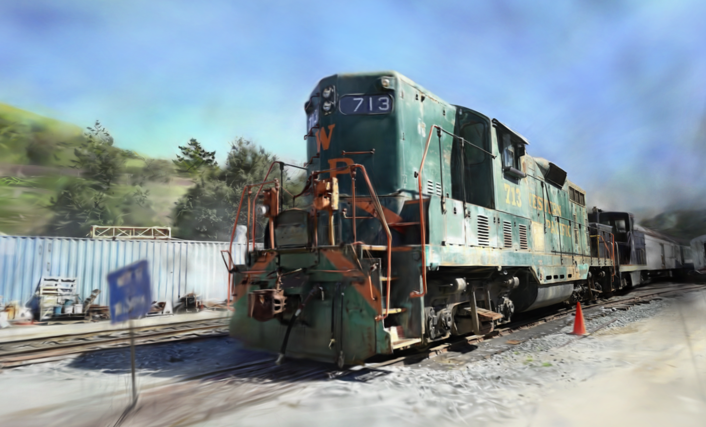
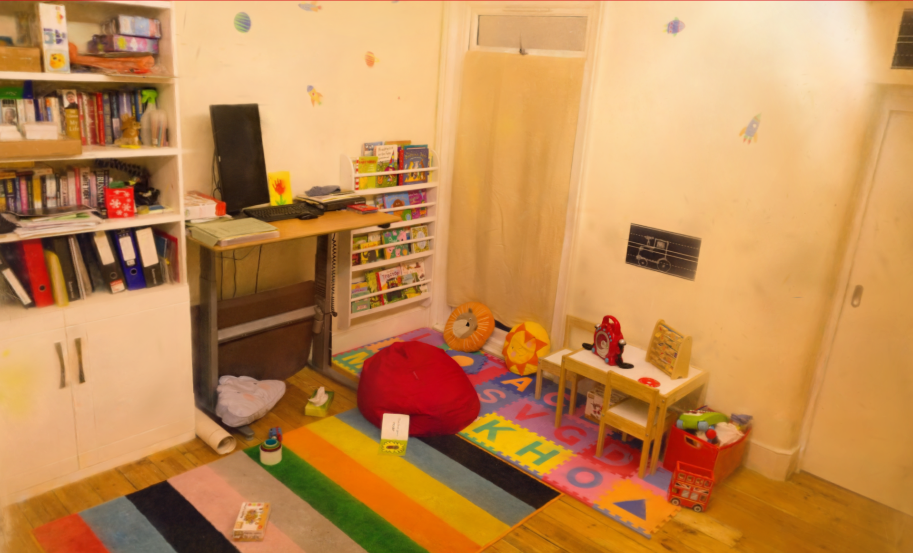
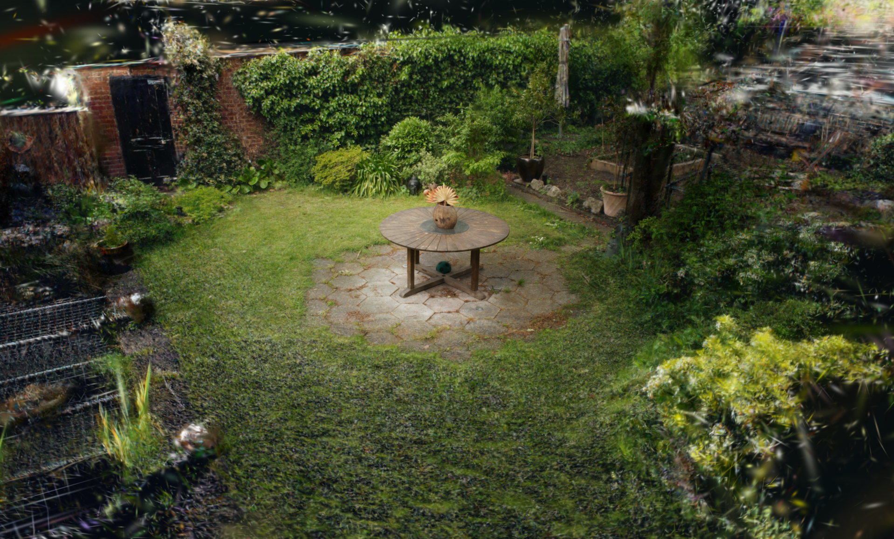

# DirectX 12 Gaussian Renderer

<p align="center">
  
  
  
</p>

A small Direct3D 12 renderer for visualizing trained 3D Gaussian Splatting scenes and experimenting with spatial reconstruction data.

## Features

- Loads binary little-endian Inria 3DGS PLY files
- Projects 3D Gaussian covariance into screen-space ellipses
- Degree-3 spherical-harmonic colour
- GPU visibility culling and compaction
- GPU radix sorting by camera depth
- Indirect drawing and alpha compositing
- Free-fly camera and diagnostic render modes

## Build

Requirements:

- Windows 10 or 11
- Visual Studio 2022 with Desktop development with C++
- Windows SDK
- CMake

```powershell
cmake --preset vs2022-x64
cmake --build --preset debug
```

The executable is written to:

```text
out/build/vs2022-x64/Debug/GaussianRenderer.exe
```

## Run

Pass a compatible trained Gaussian PLY file as the first argument:

```powershell
./out/build/vs2022-x64/Debug/GaussianRenderer.exe "C:/scenes/example/point_cloud.ply"
```

Large trained scenes are not included in the repository.

## Controls

| Input | Action |
| --- | --- |
| `W A S D` | Move |
| `Q / E` | Move down / up |
| Arrow keys or right mouse button | Look around |
| `Shift` | Move faster |
| `V` | Toggle VSync |
| `0` | Normal view |
| `1`–`6` | Diagnostic render modes |
| `Esc` | Exit |
